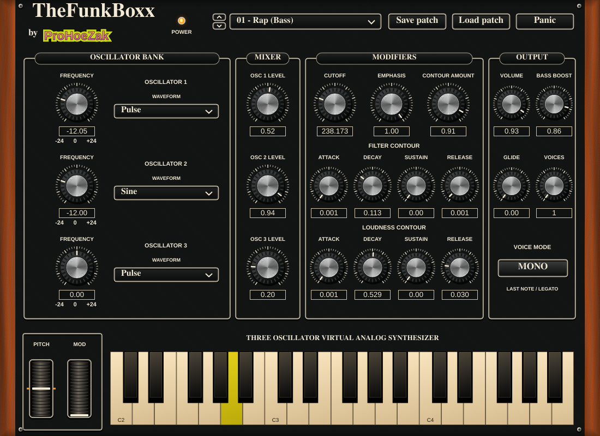

# TheFunkBoxx by ProHoeZak

TheFunkBoxx 1.3.1 is a macOS standalone synthesizer, Audio Unit and VST3 instrument for Apple Silicon and Intel Macs (macOS 11+). It retains the completed BASSBOXX synthesis and performance functions, with the requested black textured panel, cream trim, silver knobs and TheFunkBoxx branding.



## Sounds and controls

All three formats share 125 built-in sounds: 25 original ProHoeZak patches first (slots 1–25, Rap through Zapp), followed by the original 100 factory programs (slots 26–125). The dropdown and up/down arrows browse the complete bank. The original `.bassboxx` files are included under `Presets/ProHoeZak` and in each product ZIP. Their names and sound parameters are preserved. Fresh instances open on Rap. Existing saved states keep their sound settings and migrate to the corresponding new program positions.

Three oscillators, mixer, resonant low-pass filter, separate amplitude/filter ADSR contours, Bass Boost, output, glide, 1–16 voices, Mono/Poly with last-note legato, pitch bend, modulation, sustain, MIDI keyboard, Panic, automation, project-state recall and patch save/load remain available. Original parameter IDs, patch format and factory program indices are retained. The standalone continues to use existing BASSBOXX settings.

## Install and test on your Mac

The new download is published only after the updated Mac build and validation succeed. Previous BASSBOXX downloads do not contain this skin or the 125-sound bank. See [releases](https://github.com/prohoezak-hue/bassboxx/releases) and [build status](https://github.com/prohoezak-hue/bassboxx/actions/workflows/build.yml).

For the signed distribution, download **TheFunkBoxx-macOS-Installer.dmg** and open it. Quit your music host, open **Install TheFunkBoxx.app**, and click **Install** to install AU and VST3 into your user plugin folders. For standalone, drag the included **TheFunkBoxx.app** into Applications and open it. Existing BASSBOXX installations stay in place. The DMG also includes the 25 original preset files.

In standalone, choose **Options > Audio/MIDI Settings** to select your audio output and MIDI controller. In MPC, enable Audio Units and rescan plugins, then select **TheFunkBoxx**. Test playback, all 125 sounds, automation, patch save/load and project recall. Offline validation does not certify MPC compatibility or replace testing on your Mac.

## Development

CMake 3.22+, C++17 and pinned JUCE 8.0.6 are required. CMake verifies the JUCE source archive SHA-256. On macOS:

```sh
cmake -S . -B build -DCMAKE_BUILD_TYPE=Release '-DCMAKE_OSX_ARCHITECTURES=arm64;x86_64' -DCMAKE_OSX_DEPLOYMENT_TARGET=11.0
cmake --build build --config Release --parallel 3
ctest --test-dir build -C Release --output-on-failure
```

Linux builds shared processor/editor tests, not Mac plugin binaries. For portable DSP tests without JUCE:

```sh
cmake -S . -B build-engine -DBASSBOXX_ENGINE_ONLY=ON -DCMAKE_BUILD_TYPE=Release
cmake --build build-engine --parallel 2
ctest --test-dir build-engine --output-on-failure
```

The workflow builds/tests universal AU, VST3 and standalone products, runs host checks and external validators, and verifies packaged local-build/installation paths. The signed distribution additionally signs with Developer ID, submits the installer, standalone and DMG for Apple notarization, and staples accepted tickets. Signing secrets remain in GitHub Actions. No security settings or quarantine protections are disabled.

## Distribution and licensing

Project copyright remains with its owner; no public redistribution license for original source is granted here. JUCE is separately available under AGPLv3 or commercial terms. Before distribution, choose and comply with the appropriate [JUCE license](https://juce.com/legal/juce-8-licence/) and bundled notices. No commercial JUCE license is supplied.

`VALIDATION.md` records the earlier BASSBOXX releases; it is historical evidence, not a claim that this renamed build has passed Mac validation.
