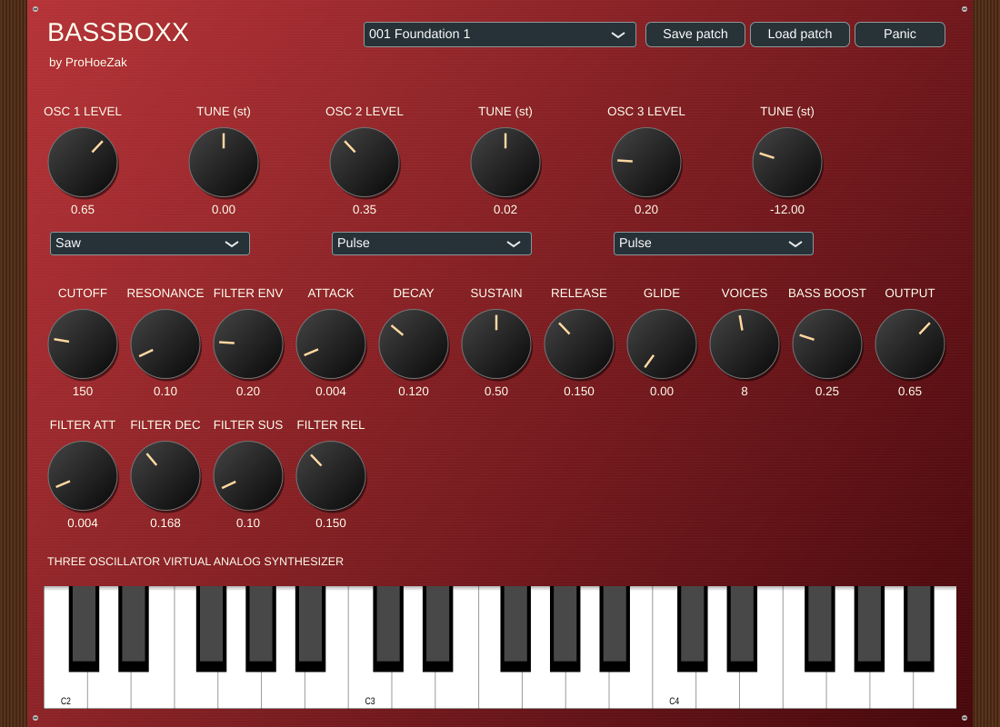

# BASSBOXX by ProHoeZak

A playable C++17/JUCE virtual analog instrument, built as a macOS VST3 and standalone application. This initial implementation follows the specifications in the project request; no separate original specification document was supplied.



[Listen to the engine demo](examples/BASSBOXX-demo.wav) · [Validation details](VALIDATION.md)

## Play it on your Mac

The simplest route is to open the repository's **Actions → Build and test** after the first push. When the macOS job succeeds, download **BASSBOXX-macOS**, unzip the artifact and its contained plugin ZIP, and copy **BASSBOXX.vst3** to `~/Library/Audio/Plug-Ins/VST3/` (Finder → Go → Go to Folder). These are development builds, not Developer ID signed/notarized releases. A Mac may require local ad-hoc signing: `codesign --force --deep --sign - "$HOME/Library/Audio/Plug-Ins/VST3/BASSBOXX.vst3"`. Don't disable macOS security globally. If organizational policy blocks development plugins, use an approved signed build.

To build locally, install Apple's Command Line Tools (`xcode-select --install`) and CMake (`brew install cmake` if you use Homebrew), download/clone this repository, then double-click **scripts/build-mac.command** or run `bash scripts/build-mac.command` in Terminal. It builds Apple Silicon + Intel, runs the tests, installs to your user VST3 folder and ad-hoc signs the plugin. The first build downloads pinned JUCE 8.0.6 and requires Internet access. Minimum target macOS 11. Compilation and installation errors stop the script. The standalone app is in `build-mac/BASSBOXX_artefacts/Release/Standalone/`.

### Akai MPC desktop

1. Use an MPC desktop version that supports third-party **VST3 instrument plugins** on macOS. VST2-only versions cannot load this build; update MPC if necessary. This project does not produce VST2.
2. Restart MPC after installation. In its plugin preferences/manager enable and scan the user VST3 directory above. Names and menus vary by MPC version.
3. Create a plugin program/track, choose **BASSBOXX**, route your MIDI controller or MPC pads to it, and enable track monitoring. Choose an audio device and begin at 44.1 or 48 kHz, 256 samples.
4. Play notes or click the three-octave keyboard (C3–B5 in scientific pitch notation, MIDI 48–83; host octave labels may differ). Check both audio channels. Start with low monitor volume; Bass Boost adds substantial low-frequency energy.
5. Select factory patches, automate cutoff/boost, save an MPC project, close and reopen it, and verify patch recall. Test sustain CC64, pitch bend (±2 semitones), polyphony and Panic. Export/bounce a short MIDI pattern and compare it to live playback.
6. Test the same plugin architecture as your host. The universal binary supports native Apple Silicon and Intel/Rosetta. MPC hardware standalone mode cannot load arbitrary desktop VST3 plugins.

Actual macOS compilation, plugin scanning, UI inspection, MIDI hardware, real-time latency, CPU behavior, project recall in MPC, and listening tests require a Mac and MPC. Linux tests do not certify MPC compatibility.

## Instrument

- Three mixed oscillators: band-limited polyBLEP saw/pulse, triangle and sine; level and ±24-semitone fine/interval tuning per oscillator. Triangle is analytic rather than fully band-limited, so extreme notes can alias.
- Driven two-pole TPT resonant low-pass; cutoff, resonance and envelope modulation. Independent amplitude and filter ADSR contours.
- Independent amplitude/filter attack, decay, sustain, release; exponential frequency glide; 1–16 voices with oldest-voice stealing. Mono mode glides from the previous voice; it does not implement a held-note priority stack.
- Bass Boost adds a 160 Hz low-pass component before soft saturation; output gain and soft limiting bound the output. This is a virtual analog design, not a measured emulation of a particular hardware synth.
- Sample-position MIDI note events, velocity, per-channel sustain and pitch bend, all-notes/all-sound-off, plus on-screen keyboard. Audio is dual mono. No external audio input.
- 100 deterministically generated factory programs: ten variations in each of Foundation, Glide, Acid, Pluck, Sub, Fifth, Atmosphere, Vintage, Lead and Impact. These are starting patches, not a separately auditioned commercial sound library.
- Host automation for all synthesis parameters; host state stores parameter values and factory program index. Save/load custom `.bassboxx` files using the editor buttons. Factory programs remain immutable. Imported custom patches retain their saved program index but the parameter state is authoritative.
- Metallic red procedural panel, wood-grain side cheeks, black rotary knobs and ProHoeZak branding. No external image assets are required.

## Development

```sh
cmake -S . -B build -DCMAKE_BUILD_TYPE=Release
cmake --build build --parallel 2
ctest --test-dir build --output-on-failure
```

Optional `-DJUCE_SOURCE_DIR=/absolute/path/to/JUCE` uses an existing JUCE 8.0.6 checkout. JUCE is pinned to commit `51a8a6d7aeae7326956d747737ccf1575e61e209` otherwise. Linux plugin builds need ALSA, X11/Xext/Xinerama/Xrandr/Xcursor, FreeType/fontconfig and OpenGL development packages (standard Debian packages `libasound2-dev libx11-dev libxext-dev libxinerama-dev libxrandr-dev libxcursor-dev libfreetype-dev libfontconfig1-dev libgl1-mesa-dev`). No audio hardware or display is needed for the automated tests.

Portable engine-only tests need just CMake and a C++17 compiler:

```sh
cmake -S . -B build-engine -DBASSBOXX_ENGINE_ONLY=ON
cmake --build build-engine
ctest --test-dir build-engine --output-on-failure
```

`Source/Engine.h` contains portable DSP; `Plugin.cpp` handles JUCE MIDI/automation/state; `Editor.h` implements controls and patch files. Engine tests check audio, release, pedal, voice stealing, bounds, Bass Boost, and all 100 presets at three rates. Processor tests exercise actual JUCE MIDI sample timing, audio output, programs and state roundtrips. CI also builds the universal macOS VST3/standalone. See `VALIDATION.md` for the observed cloud results.

## Distribution and licensing

Project copyright remains with its owner; no public redistribution license for original source is granted here. JUCE is a separate dependency available under AGPLv3 or commercial terms. Before distributing a plugin or source, choose and comply with the appropriate JUCE license (https://juce.com/legal/juce-8-licence/) and its bundled third-party notices. Merely compiling or linking does not establish a commercial license. Public macOS distribution also needs your Apple Developer signing/notarization workflow; no signing credentials are included.
